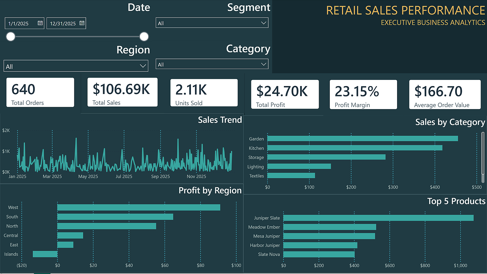

# Retail Sales Analysis Dashboard

## Project Overview
An interactive Retail Sales Analysis dashboard developed using Microsoft Power BI.

The project focuses on analyzing sales performance, profitability, customer segments, product categories, and regional sales.

## Tools & Technologies
- Microsoft Power BI
- Power Query
- DAX
- Data Modeling

## Key Performance Indicators (KPIs)
- Total Sales
- Total Profit
- Profit Margin
- Total Orders
- Average Order Value
- Units Sold

## Dashboard Preview

## Project Structure
- Data: Source datasets
- Dashboard: Power BI project file
- Images: Dashboard screenshots